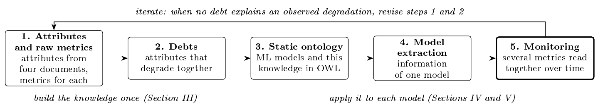
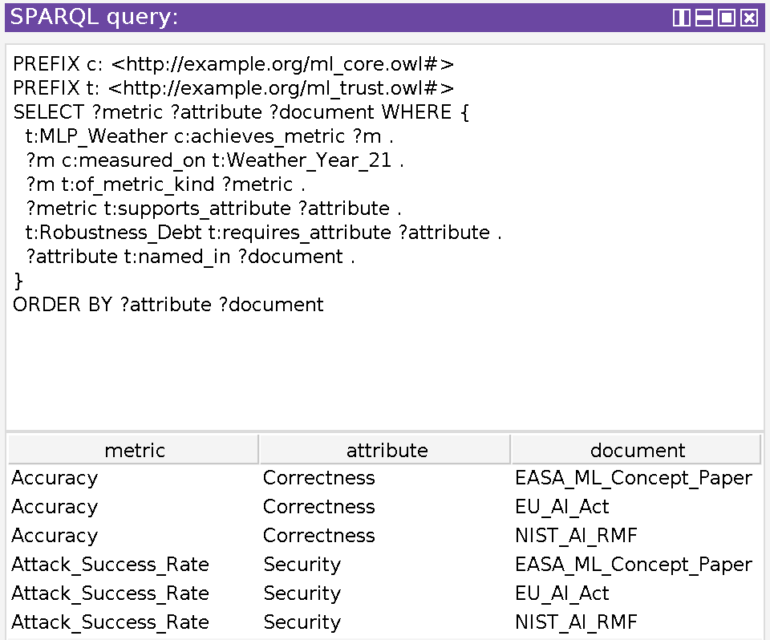

# Model Specific Trustworthiness Debt in Learning Enabled Systems Using an Ontology

[](https://colab.research.google.com/github/anonimoustt/IEEESyscon_2027/blob/main/colab_demo.ipynb) the whole study in one run

[](https://colab.research.google.com/github/anonimoustt/IEEESyscon_2027/blob/main/syscon2027_experiment_walkthrough.ipynb) the experiment step by step, with every number checked against the paper

Code, ontology, and queries for the paper *Model Specific Trustworthiness Debt in Learning Enabled Systems Using an Ontology*, submitted to the IEEE International Systems Conference (SysCon) 2027.

Trustworthiness debt is a joint deficit that arises when several trustworthiness attributes of a deployed machine learning (ML) model degrade together. The paper shows that one metric observed over time is not sufficient to detect and explain a failure, while two or more related metrics read together are.

## The pipeline



The pipeline has five steps. Steps 1 and 2 build the trustworthiness knowledge once. Steps 3 to 5 apply it to each model. The pipeline is iterative: when the monitor in step 5 sees attributes degrade together in a pattern that no debt describes, steps 1 and 2 are revised.

| Step | What happens | Where in this repository |
|---|---|---|
| 1. Attributes and raw metrics | Seven trustworthiness attributes are extracted from four established documents: the Artificial Intelligence Risk Management Framework of the National Institute of Standards and Technology (NIST AI RMF), the Artificial Intelligence Act of the European Union (EU AI Act), the machine learning concept paper of the European Union Aviation Safety Agency (EASA), and the 7010 standard of the Institute of Electrical and Electronics Engineers (IEEE 7010). 21 raw metrics are linked to the attributes they measure. | `ATTR` and `LINKS` in `code/build_static_ontology.py` |
| 2. Debts | Six trustworthiness debts, each a set of attributes that degrade together, plus the history event two of them need. | `TDI` and `requires_provenance` in `code/build_static_ontology.py` |
| 3. Static ontology | One Web Ontology Language (OWL) file with the ML models and this knowledge; it opens in Protégé. | `ontology/trustworthiness_debt.owl`, built by `code/build_static_ontology.py` |
| 4. Model extraction | Queries read the information of one model: task, algorithm, parameters, inference time, metrics, and thresholds. They are SPARQL Protocol and RDF Query Language (SPARQL) queries and Description Logic (DL) queries; RDF stands for Resource Description Framework. | `queries/`, `code/ask.py`, `code/run_queries.py`, `code/run_dl_queries.py` |
| 5. Monitoring | The monitor trains the model on weather data from the National Oceanic and Atmospheric Administration (NOAA), sets thresholds from 200, 400, 800, and 1,600 resampled years (averaged), validates them on 5,000 new resampled years, and applies them to 40 years of operation with ten metrics. | `code/ontology_monitor.py`, checked by `code/weather_debt_check.py` |
| Iterate | Revise steps 1 and 2 and run again. | edit `ATTR`, `LINKS`, or `TDI`, then `python run_all.py` |

## Repository layout

| Path | Content |
|---|---|
| `colab_demo.ipynb` | the whole study in one notebook, ready for Google Colab |
| `syscon2027_experiment_walkthrough.ipynb` | Section IV step by step: data, ontology queries, metrics, resampled years, thresholds, validation, monitoring, and a final check of 14 numbers against the paper |
| `data/noaa_weather_offutt_1949_1999.csv` | the two public weather files joined row by row, with column names |
| `run_all.py` | reproduces every result in about ten minutes |
| `code/` | all scripts; every line is commented |
| `queries/` | the twelve SPARQL queries (`Q1` to `Q12`, every line commented) and the seven DL queries (`dl_queries.txt`) |
| `ontology/` | `trustworthiness_debt.owl` (static), `trustworthiness_debt_with_thresholds.owl` (after the thresholds and inference times are written in), and `failure_path_MLP_Weather_year21.owl` (a copy with the record of year 21, for tracing a failure); all open in Protégé 5.6.4 |
| `results/` | the outputs of `run_all.py`, committed so you can inspect them without running anything |
| `docs/pipeline.png`, `docs/pipeline_tikz.tex` | the pipeline figure (Fig. 1 of the paper) and its LaTeX source |
| `requirements.txt`, `requirements_exact.txt` | minimum versions, and the exact versions behind the paper |
| `set_github_user.py` | writes your GitHub user name into the Colab badge and the notebook |

### Scripts in `code/`

| Script | Purpose |
|---|---|
| `build_static_ontology.py` | builds the static ontology: core ML layer, trustworthiness extension, model catalog, case studies |
| `run_queries.py` | runs every SPARQL file on an ontology and saves one CSV per query plus `query_results.md` |
| `run_dl_queries.py` | runs the seven DL queries with the HermiT reasoner through Owlready2 |
| `ask.py` | runs one SPARQL query for one model and prints a table (also importable as `run_query`) |
| `download_weather.py` | downloads the NOAA weather data and checks both files by SHA256 |
| `weather_debt_check.py` | independent check: recomputes all metric values, thresholds, and decisions without the ontology (library routines where possible) and compares them with the monitor |
| `ontology_monitor.py` | the monitor: model information, metrics, links, debts, and history come from the ontology; it sets the thresholds, validates them, writes them back, and monitors years 11 to 50 |
| `fig_weather.py` | draws a figure of the 40 monitored years (Table V of the paper groups the years of the network) |
| `paper_numbers.py` | computes every number of the weather experiment (Section IV of the paper, Tables IV to VI) |
| `clean_rates_example.py` | recomputes the validation rates of Table VI for either model from the 5,000 validation years (`python code/clean_rates_example.py . LR_Weather`) |
| `failure_path.py` | writes the record of one monitored year (default year 21 of `MLP_Weather`) into a copy of the ontology, so the failure path can be followed in Protégé; the static ontology is not changed |
| `worked_example.py` | shows the first resampled year, the thresholds of the four runs and their average (Section IV.D), and how year 31 of `MLP_Weather` is judged step by step (`python code/worked_example.py`) |

## Quick start on Google Colab

The Colab badge above works only after two things: the repository is **public** on GitHub, and the placeholder user name in the badge has been replaced by yours (run `python set_github_user.py YOUR_NAME` before you push, as in *Publish on GitHub*). Until then the badge returns *404 Not Found*.

**Option A, from GitHub.** Open `colab_demo.ipynb` through the badge, or in Colab choose File, Open notebook, GitHub, type your user name, and pick the notebook. In section 2, `GITHUB_USER` must hold your user name. Then choose Runtime, Run all.

**Option B, without GitHub.** In Colab choose File, Upload notebook, and pick `colab_demo.ipynb`. In section 2 set `GITHUB_USER = ""` (empty), then choose Runtime, Run all. When section 2 shows an upload button, choose `model_specific_trust_debt.zip`.

Either way the notebook installs Java and two libraries, runs everything, and shows the query answers, the tables, and the figure.

## Quick start on your own computer

You need Python 3.10 or newer and Java 11 or newer (the HermiT reasoner runs in Java).

```
pip install -r requirements.txt
python run_all.py                    # downloads the data into data/weather, then runs all steps
python run_all.py /path/to/data      # or use a folder that already holds the two CSV files
```

Use Owlready2 0.48. Version 0.51 ships a reasoner jar built for Java 25.

**Exact numbers.** The paper numbers come from the versions in `requirements_exact.txt`. Training a neural network can differ slightly between NumPy, SciPy, and scikit learn releases. With other versions the monitor still agrees with the independent check on every decision, because both run in the same environment, but a count may move by one or two. The inference time depends on the computer.

**Data cleaning.** Two records of year 10 (rows 3596 and 3597 of the files) hold an impossible sea level pressure of about 5,503 hPa. The monitor and the independent check replace both with the last valid value, 1,007.8 hPa.

## What `run_all.py` does

| Step | Output |
|---|---|
| 1. download and check the data | `data/weather/` |
| 2. build the static ontology | `ontology/trustworthiness_debt.owl` |
| 3. SPARQL queries Q1 to Q12 | `results/queries_static/` |
| 4. DL queries D1 to D7 (HermiT) | `results/dl_queries.json` |
| 5 and 6. monitor for both models | `results/monitor/` and `ontology/trustworthiness_debt_with_thresholds.owl` |
| 7 and 8. independent check for both models | `results/monitor/cross_check_*.json` |
| 9. SPARQL queries on the ontology with thresholds | `results/queries_with_thresholds/` (Q8 now lists the thresholds) |
| 10. record of year 21 for Protégé | `ontology/failure_path_MLP_Weather_year21.owl` |
| 11. SPARQL queries on the record of year 21 | `results/queries_failure_path/` (Q12 lists the failure path) |
| 12. figure | `results/figures/weather.pdf` and `.png` |
| 13. numbers of Section IV | `results/paper_numbers.json` |

Expected agreement (in `results/monitor/cross_check_*.json`): `"decision_mismatches": 0` for both models, over 5,040 years (5,000 validation years and 40 monitored years), with metric values equal up to rounding (largest relative gap about 1e-13).

### Monitor outputs

| File | Content |
|---|---|
| `monitor_years_MODEL.csv` | years 11 to 50: metric values (`v_`), degraded metrics (`deg_`), degraded attributes, debt states, ruled out debts |
| `monitor_validation_MODEL.csv` | the same columns for the 5,000 validation years |
| `monitor_summary_MODEL.json` | thresholds of each run (200, 400, 800, 1,600) and their average, validation and monitoring counts, inference time |

## Get model information from the ontology

### In Python

```python
import sys; sys.path.insert(0, "code")         # make the helper importable
from ask import run_query                      # one query, one model, one table
run_query("Q1_model_information", "LR_Weather")  # algorithm, configurations, contexts
run_query("Q3_monitoring_plan", "LR_Weather")    # metric kinds that apply to logistic regression
```

or from the command line:

```
python code/ask.py Q1_model_information LR_Weather
```

### In Protégé (tested with 5.6.4)

**SPARQL queries**

1. File, Open, and choose `ontology/trustworthiness_debt.owl`.
2. Window, Tabs, SPARQL Query.
3. Paste the text of a `.rq` file and click Execute. The comments may stay in the text.
4. To ask about another model, change `t:MLP_Weather` in the `VALUES` line of Q1, Q2, Q3, or Q8 (for example to `t:LR_Weather`). Q4 to Q6 answer for every model at once.

**DL queries**

1. Reasoner, HermiT, then Reasoner, Start reasoner.
2. Open the DL Query tab and tick **Instances** under *Query for*.
3. Paste one expression from `queries/dl_queries.txt` (without the comment line) and click Execute.

**Trace a failure (year 21, Security)**

The static ontology never holds yearly values. `code/failure_path.py` copies the ontology and adds the record of one monitored year: one measurement for each degraded metric, linked to the model and the year. Each attribute names the documents that require it (`named_in`, Table I of the paper), so a debt traces back to the four documents.

1. File, Open, and choose `ontology/failure_path_MLP_Weather_year21.owl`.
2. Window, Tabs, SPARQL Query.
3. Paste `queries/Q12_failure_path.rq` and click Execute.



In year 21, accuracy (76.4%, below its threshold of 77.3%) degrades Correctness, and attack success rate (0.425, above 0.406) degrades Security. Both attributes form the Robustness debt, and both are named in the NIST AI RMF, the EU AI Act, and the EASA concept paper. Replace `t:Robustness_Debt` with `t:Harmful_Output` in Q12: only Security appears, because Safety did not degrade in year 21, so Harmful Output is not a debt. In the Entities tab, the individual `MLP_Weather_Year21_Attack_Success_Rate` shows the same record: its metric kind, its year, `is_degraded` true, and `has_score` 0.425.

### Expected answers

| Query | Question | Answer |
|---|---|---|
| Q1 | algorithm, configurations, contexts of a model | `MLP_Weather`: multilayer perceptron (deep learning, supervised), 2 configurations, 3 suited contexts, 1 operating context |
| Q2 | model information and monitoring settings | binary classification (rain or no rain), 161 trainable parameters, seed 0, 16 hidden units, 3,000 iterations, train on years 1 to 5, normal operation 6 to 10, monitor 11 to 50, resampled run sizes 200, 400, 800, 1,600, 5,000 validation years, 95th and 99th percentiles |
| Q3 | monitored and applicable metrics with their attributes | 10 metrics and 14 links for `MLP_Weather`; MMD and KS support Resilience only under a severe shift |
| Q4 | monitored metrics that do not apply to the algorithm | `LR_Weather`: Explanation_Stability, Explanation_Fidelity |
| Q5 | blind spots | `LR_Weather`: Transparency_Interpretability; `MLP_Weather`: none |
| Q6 | detectable debts | `MLP_Weather`: all six. `LR_Weather`: Capability_Loss, Harmful_Output, Operating_Envelope, Robustness_Debt |
| Q7 | attributes and history class of every debt | 13 rows; Capability_Loss needs Fine_Tuning_Configuration, Source_Target_Mismatch needs Transfer_Configuration |
| Q8 | thresholds | none in the static file; 10 pairs for `MLP_Weather` and 8 for `LR_Weather` in the file with thresholds |
| Q9 | case studies: degraded attributes | 9 rows |
| Q10 | case studies: detected debts and the number of metrics behind each | AssistTaxi Capability_Loss (2); language model Capability_Loss (1), Harmful_Output (2), Robustness_Debt (2) |
| Q11 | case studies: complete patterns without the needed history | ALINA_on_Runways: Capability_Loss |
| Q12 | failure path of `MLP_Weather` in year 21 (on `failure_path_MLP_Weather_year21.owl`) | Accuracy, Correctness and Attack_Success_Rate, Security, each with NIST_AI_RMF, EU_AI_Act, EASA_ML_Concept_Paper |
| D1 to D7 | DL queries | listed with their answers in `queries/dl_queries.txt` and `results/dl_queries.json` |

## How the monitor uses the ontology

| Step | Query | What happens |
|---|---|---|
| Describe | Q2 | reads the task, algorithm, parameters, seed, hidden units, iteration limit, data periods, and threshold settings; builds and trains that model |
| Plan | Q3, Q4 | reads the monitored metrics that apply to the algorithm and their attribute links; drops metrics that do not apply |
| Thresholds | Q8 | computes the 95th and 99th percentiles in runs of 200, 400, 800, and 1,600 resampled years, averages them, writes each pair into the ontology as a `Threshold_Entry` together with the measured inference time, reads them back with Q8, and uses only those values |
| Validate | | counts how often each metric crosses its threshold in 5,000 new resampled years (about 5% expected) |
| Define | Q7 | reads the attributes and history class of every debt; an ASK query checks the history of the model |
| Monitor | | for each year 11 to 50: scale the 360 days with training statistics, predict, compute the metrics, compare with the thresholds, and apply the debt rule (a debt needs all its attributes degraded by two or more different metrics) |

The code only maps two algorithm names to scikit learn classes and ten metric names to functions.

## Add a new model

In Protégé or in `code/build_static_ontology.py`, create an `ML_Model_Instance` with `implements_algorithm`, `has_configuration` (a hyperparameter configuration with `has_random_seed`, `has_max_iterations`, and optionally `has_hidden_units`; a training configuration with `has_start_year` and `has_end_year`), `suited_for_context`, `operates_on_context`, `monitors_metric_kind`, `has_task`, `has_trainable_parameters`, and `has_commissioning_profile` (the threshold profile). Record any fine tuning or transfer as a `Fine_Tuning_Configuration` or `Transfer_Configuration`. Queries Q1 to Q8 then answer for the new model, and the monitor writes its thresholds and inference time. A new algorithm also needs one line in the `ALGORITHMS` table of `code/ontology_monitor.py`.

## Publish on GitHub

1. On github.com, create an empty public repository (this one is `anonimoustt/IEEESyscon_2027`), with no README and no license.
2. In this folder, run:

```
python set_github_user.py anonimoustt          # fills in the Colab badge and the notebook
git init                                                # new local repository
git add .                                               # stage every file
git commit -m "Initial commit"                          # first commit
git branch -M main                                      # name the branch main
git remote add origin https://github.com/anonimoustt/IEEESyscon_2027.git   # link to GitHub
git push -u origin main                                 # upload
```

`download_weather.py` fetches the two public weather files into `data/weather/`, which `.gitignore` keeps out of Git. The joined file `data/noaa_weather_offutt_1949_1999.csv` is committed.

## Data

NOAA weather benchmark of Elwell and Polikar (2011): 18,159 daily records from Offutt Air Force Base, Bellevue, Nebraska, 1949 to 1999. Each record has eight features (temperature, dew point, sea level pressure, visibility, average wind speed, maximum sustained wind speed, maximum and minimum temperature) and a rain label; 5,698 days (31.4%) are rain days. Two impossible pressure values are replaced as described above. The raw measurements come from the NOAA Global Surface Summary of the Day (GSOD) archive. The data are fetched from the public copy of Losing, Hammer, and Wersing (2016), https://github.com/vlosing/driftDatasets/tree/master/realWorld/weather, and checked by SHA256. That copy has two CSV files without headers: `NEweather_data.csv` (18,159 rows, 8 feature columns) and `NEweather_class.csv` (18,159 labels, 1 = rain, 0 = no rain). `data/noaa_weather_offutt_1949_1999.csv` joins them row by row with the columns `day`, `year_block`, `temperature`, `dew_point`, `sea_level_pressure`, `visibility`, `average_wind_speed`, `max_sustained_wind_speed`, `max_temperature`, `min_temperature`, and `rain`; `year_block` numbers the periods of 360 days, and block 51 holds the 159 records that the experiment does not use.

* R. Elwell and R. Polikar, "Incremental learning of concept drift in nonstationary environments," *IEEE Transactions on Neural Networks*, 22(10), 1517 to 1531, 2011.
* G. Ditzler and R. Polikar, "Incremental learning of concept drift from streaming imbalanced data," *IEEE Transactions on Knowledge and Data Engineering*, 25(10), 2283 to 2301, 2013.
* NOAA National Centers for Environmental Information, "Global Surface Summary of the Day (GSOD)," version 1.0, dataset gov.noaa.ncdc:C00516.
* V. Losing, B. Hammer, and H. Wersing, "KNN classifier with self adjusting memory for heterogeneous concept drift," *Proc. IEEE ICDM*, 291 to 300, 2016.

## License

MIT, see `LICENSE`.
